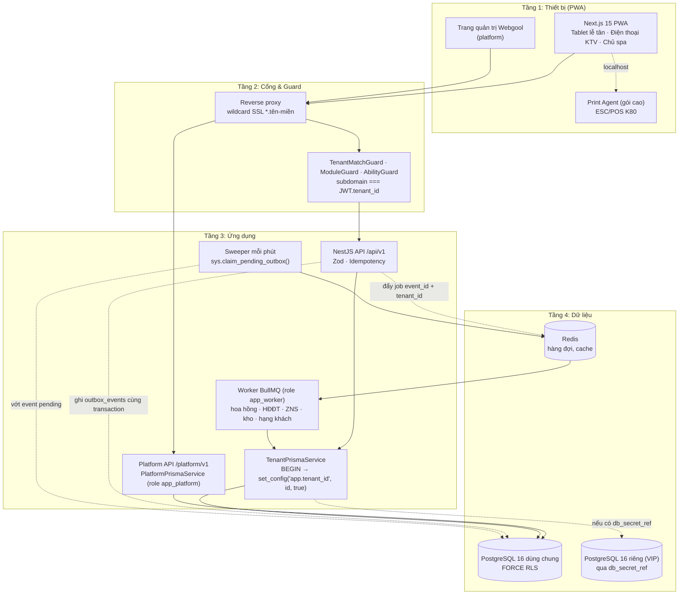

# Master Plan – Phần mềm quản lý Spa SaaS

Phiên bản: 2.0 · Cập nhật: 29/10/2026 · Chủ dự án: dnduy

Tài liệu gốc (Single Source of Truth) của dự án. Mọi spec module, mọi prompt giao cho AI và mọi review code phải khớp với tài liệu này. Có mâu thuẫn thì sửa tài liệu trước, code sau. Mọi thay đổi quyết định kiến trúc phải có ADR trong `docs/adr/`.

**Thay đổi so với bản 1.x**

- Hoa hồng: bỏ động cơ công thức tự do (AST) khỏi MVP. Chủ spa khai báo quy tắc qua biểu mẫu: phạm vi, cấp KTV, cơ sở tính, % hoặc số tiền cố định (mục 4, M12).
- Ghi sổ tiền và số buổi liệu trình chạy **đồng bộ** trong transaction thanh toán; outbox chỉ dùng cho việc được phép chậm (hoa hồng, HĐĐT, ZNS, kho, hạng khách).
- Buổi dùng gói liệu trình luôn đi qua một đơn 0đ để có bill, sổ sách và hoa hồng thống nhất.
- Bổ sung vai trò DB và hàm `sys.*` cho tác vụ xuyên tenant (sweeper outbox, xác định tenant); `tenants.db_url` đổi thành `db_secret_ref`.
- Sửa cột `occupied_until`: dùng trigger thay cho cột generated (Postgres không cho phép biểu thức không immutable).
- Khôi phục giai đoạn khảo sát spa ở tuần 1–2; M17 không xây trong tuần pilot.
- Bổ sung quy tắc bảo mật dữ liệu: ghi chú sức khoẻ, khoá PIN, xuất/xoá dữ liệu khi spa ngừng thuê.

---

## 1. Phạm vi & quyết định đã chốt

Sản phẩm là SaaS bán theo thuê bao: mỗi spa mua một store riêng, dữ liệu cách ly tuyệt đối, vận hành trọn vòng từ đặt lịch đến thu tiền, in bill, tính hoa hồng và hoá đơn điện tử. Module mở rộng bật/tắt theo gói cước và nhu cầu từng spa.

| Hạng mục | Quyết định | Hệ quả bắt buộc |
| --- | --- | --- |
| Khách mục tiêu | Spa nhỏ, 1 cơ sở, bán đại trà; gói cao hỗ trợ nhiều chi nhánh | Onboarding tự phục vụ dưới 15 phút, mặc định dùng được ngay |
| Kiến trúc dữ liệu | 1 PostgreSQL 16 dùng chung + Row-Level Security | Mọi bảng nghiệp vụ có `tenant_id`; `tenants.db_secret_ref` cho phép tách DB riêng khách VIP |
| Stack | Next.js 15 (PWA) + NestJS, TypeScript toàn bộ, monorepo pnpm + Turborepo | Dùng chung type, Zod schema, hàm tính tiền, hàm tính hoa hồng giữa web và API |
| Bật/tắt module | Module lõi luôn bật; module mở rộng bật/tắt động | API guard, worker và giao diện tự bỏ qua module đang tắt |
| Phân quyền | RBAC động + điều kiện (`conditions`) | 4 vai trò mẫu; chủ spa tạo vai trò mới, chỉnh ngưỡng giảm giá, che SĐT, phạm vi chi nhánh |
| Hoa hồng | Quy tắc do chủ spa khai báo qua biểu mẫu | Không có ô nhập công thức tự do trong MVP; có mẫu sẵn khi onboarding |
| Bill nội bộ & HĐĐT | 2 module độc lập: Bill nội bộ (M11, lõi) và HĐĐT (M17, bật/tắt) | Tắt hoặc lỗi HĐĐT thì spa vẫn thu tiền, đánh số bill, in K80 bình thường |
| Thiết bị | PWA, không app native trong MVP | Tablet quầy (≥ 768px) và điện thoại KTV (360px) |
| Đội phát triển | Claude, Antigravity, Muse; dnduy duyệt | Spec trước, test tự động là cổng chặn, không merge khi test đỏ |

**Nguyên tắc sản phẩm (dùng để phân xử khi tranh luận tính năng):**

1. Lễ tân làm xong một thao tác thường gặp trong tối đa 3 chạm.
2. Tiền không bao giờ sai: mọi con số tài chính truy được nguồn, không sửa, chỉ bù trừ bằng giao dịch đối ứng.
3. Một spa không bao giờ nhìn thấy dữ liệu của spa khác, kể cả khi code ứng dụng có lỗi.
4. Mặc định hợp lý, cấu hình là tuỳ chọn.
5. Chỉ xây tính năng khi ít nhất 3 spa cần; nhu cầu của 1 spa giải quyết bằng cấu hình hoặc từ chối.

**Ngoài phạm vi MVP:** app native, kế toán tổng hợp (sổ cái kế toán, BCTC), bảng lương đầy đủ (BHXH, thuế TNCN), marketplace, AI gợi ý, ô nhập công thức hoa hồng tự do.

---

## 2. Kiến trúc hệ thống

Một web, một API (modular monolith), một worker, một cơ sở dữ liệu dùng chung. Lớp gắn tenant đứng giữa API và dữ liệu; RLS ở Postgres là lớp chặn cuối cùng.



### Cơ chế cốt lõi

- **Xác định tenant:** subdomain cho biết store. API gọi `sys.resolve_tenant(slug)` để lấy `tenant_id`, `timezone`, `status`. JWT đăng nhập chứa `tenant_id`. `TenantMatchGuard` so khớp hai giá trị, lệch thì trả `403 TENANT_MISMATCH`.
- **Gắn tenant vào dữ liệu (Unit of Work):** `TenantPrismaService` mở transaction, câu đầu tiên là `SELECT set_config('app.tenant_id', $1, true)`, sau đó mới chạy truy vấn nghiệp vụ.
- **Bật/tắt module:** module hoạt động khi `tenant_modules.entitled = true` (gói cước cho phép, do platform ghi) **và** `tenant_modules.enabled = true` (chủ spa bật).
- **Ghi sổ đồng bộ, việc phụ bất đồng bộ (ADR-003):** mọi thay đổi tiền, sổ cái, số buổi gói, số bill, trạng thái lịch chạy trong **cùng một transaction** thanh toán. Việc được phép chậm ghi vào `outbox_events` trong transaction đó; sau commit API đẩy job `{event_id, tenant_id}` vào Redis. Sweeper mỗi phút vớt event `pending` quá 30 giây (rớt lúc đẩy job) qua hàm `sys.claim_pending_outbox()`.
- **Tác vụ xuyên tenant (ADR-002):** ứng dụng không bao giờ dùng role có `BYPASSRLS`. Những việc bắt buộc nhìn qua nhiều tenant (xác định tenant từ subdomain, vớt outbox) đi qua hàm `SECURITY DEFINER` trong schema `sys`, mỗi hàm làm đúng một việc, trả về tối thiểu cột.
- **Khách VIP:** `ConnectionResolver` đọc `tenants.db_secret_ref` (tên khoá trong kho bí mật hoặc biến môi trường), lấy chuỗi kết nối và mở pool riêng. DB riêng có cùng schema, cùng RLS. Sweeper và lệnh migrate phải chạy trên mọi DB đã đăng ký.
- **In bill:** MVP in qua trình duyệt (CSS khổ K80). Gói cao dùng `print-agent` chạy trên máy quầy để in ESC/POS trực tiếp.
- **Hạ tầng khởi điểm:** 1 VPS chạy Docker Compose (web, api, worker, Postgres 16, Redis, reverse proxy wildcard SSL). Backup Postgres hằng ngày + WAL archiving ra lưu trữ ngoài máy chủ, giữ 30 ngày. Diễn tập khôi phục trước khi mở bán.

---

## 3. Quy trình nghiệp vụ

### Luồng một lượt khách

Lễ tân và KTV làm 5 thao tác; trừ buổi gói, ghi sổ thẻ, ghi sổ quỹ, cấp số bill diễn ra đồng bộ lúc đóng đơn; hoa hồng, HĐĐT, ZNS, trừ kho chạy nền.

| Bước | Trạng thái dòng lịch | Người làm | Thao tác (tối đa 3 chạm) | Hệ thống tự làm |
| --- | --- | --- | --- | --- |
| 1. Đặt lịch / Walk-in | `booked` (walk-in: `in_progress`) | Lễ tân | Chọn khách (4 số cuối SĐT) → chọn dịch vụ → chọn giờ/KTV/giường, hoặc bấm "Khách vãng lai" | Chống trùng KTV và giường (BR-01), gợi ý KTV theo tua (BR-06), tính thời lượng (BR-02), cảnh báo nếu gói liệu trình của khách sắp hết hạn hoặc hết buổi |
| 2. Đón khách | `arrived` | Lễ tân | Chạm thẻ lịch → **Check-in** | Ghi giờ đến thực tế, hiện ghi chú lưu ý của khách cho người có quyền xem (BR-60) |
| 3. Phục vụ | `in_progress` | KTV hoặc lễ tân | **Bắt đầu** | Ghi giờ bắt đầu thực tế |
| 4. Hoàn thành | `completed` | KTV hoặc lễ tân | **Hoàn thành** | Phát `APPOINTMENT_COMPLETED` → trừ vật tư nếu bật kho (BR-50) |
| 5. Đóng đơn | `paid` | Thu ngân | Mở đơn của lịch → chọn phương thức (tiền mặt, VietQR, thẻ, thẻ trả trước, trừ gói) → **Thu tiền** (đơn 0đ: **Đóng đơn**) | Trong 1 transaction: kiểm tra ca mở (BR-15), tính tiền (BR-11), trừ buổi gói (BR-21), ghi sổ thẻ trả trước (BR-23), cấp số bill (BR-40), ghi sổ quỹ, chuyển dòng lịch sang `paid`, ghi `ORDER_PAID` vào outbox |
| 6. Sau đóng đơn | — | Hệ thống | Tự bật hộp thoại in bill K80 | Worker theo module đang bật: tính hoa hồng (M12), phát hành HĐĐT (M17), ZNS cảm ơn (M15), cập nhật chi tiêu và hạng khách (M05) |

Sai sót sau khi đóng đơn xử lý bằng phiếu hoàn/điều chỉnh tham chiếu đơn gốc (BR-14), không sửa hoặc xoá đơn.

### Quy trình mở store cho spa mới (mục tiêu dưới 15 phút)

1. **Đăng ký:** tên spa, SĐT, chọn subdomain → hệ thống tạo tenant, chi nhánh mặc định, 4 vai trò mẫu, bật các module của gói dùng thử 14 ngày.
2. **Chọn mẫu ngành:** Massage trị liệu, Nối mi – Nail, Chăm sóc da → nạp danh mục dịch vụ mẫu và bộ quy tắc hoa hồng mẫu (chủ spa sửa lại số).
3. **Cơ sở và nhân sự:** nhập phòng/giường, nhân viên và cấp KTV (hoặc tải file Excel mẫu).
4. **Mẫu in K80:** logo, địa chỉ, SĐT, MST, tài khoản nhận VietQR; in thử 1 bill.
5. **Mời nhân viên:** gửi link qua Zalo; nhân viên đăng nhập bằng SĐT + mật khẩu, đặt PIN riêng.

### Quy trình trong ngày của thu ngân

1. **Đầu ca:** mở ca, nhập tiền mặt đầu ca (BR-15).
2. **Trong ca:** đóng đơn cho từng lượt khách; chi vặt và chi tip hộ KTV ghi phiếu chi vào sổ quỹ ca (BR-16).
3. **Cuối ca:** hệ thống cảnh báo lịch đã hoàn thành mà chưa đóng đơn (BR-17); thu ngân đếm tiền mặt, hệ thống đối chiếu, lệch thì bắt buộc nhập lý do, in phiếu chốt ca (BR-43).
4. **Cuối ngày:** chủ spa xem doanh thu thực thu, doanh thu thực hiện, danh sách HĐĐT gửi lỗi (nếu bật M17).

### Phân quyền mặc định (chủ spa chỉnh được)

| Quyền | Chủ spa | Quản lý | Lễ tân / Thu ngân | KTV | Điều kiện chỉnh được (`conditions`) |
| --- | --- | --- | --- | --- | --- |
| Xem SĐT khách | Đầy đủ | Đầy đủ | Che giữa (`0935***434`) | Không | `mask_customer_phone: boolean` |
| Xem ghi chú sức khoẻ khách | Có | Có | Không | Khách của lịch mình đang làm | `data_scope` |
| Tạo/sửa lịch hẹn | Mọi chi nhánh | Chi nhánh hiện tại | Chi nhánh hiện tại | Chỉ xem lịch mình | `data_scope: all_branches \| current_branch \| own_only` |
| Thu tiền, in bill | Có | Có | Có | Không | — |
| Giảm giá | 100% | Tối đa 50% | Tối đa 10% | Không | `max_discount_percent` (vượt → PIN, BR-13) |
| Hoàn tiền đơn đã thu | Có | Có (PIN) | Không | Không | `max_refund_amount` |
| Sửa giá dịch vụ, quy tắc hoa hồng | Có | Không | Không | Không | — |
| Xem báo cáo doanh thu | Mọi chi nhánh | Chi nhánh hiện tại | Ca của mình | Không | `data_scope` |
| Xem hoa hồng | Tất cả | Tất cả | Không | Của mình | `data_scope` |
| Bật/tắt module, phân quyền, gói cước | Có | Không | Không | Không | Chỉ vai trò `owner` |

---

## 4. Quy tắc nghiệp vụ

Mỗi quy tắc có mã BR-xx để spec, test (`it('[BR-xx] ...')`) và commit dẫn chiếu.

### Lịch hẹn & điều phối KTV (M06, M07)

| Mã | Quy tắc |
| --- | --- |
| BR-01 | Một KTV hoặc một giường không có 2 dòng lịch hoạt động giao nhau, tính cả thời gian dọn `cleanup_minutes` (mặc định 10 phút, cấu hình theo dịch vụ). Chặn ở cấp DB bằng exclusion constraint (mục 5). |
| BR-02 | Thời lượng một dòng lịch = thời lượng dịch vụ; sửa dịch vụ thì giờ kết thúc tự tính lại. |
| BR-03 | Trạng thái dòng lịch (`appointment_items.status`) đi một chiều: `booked → arrived → in_progress → completed → paid`. Nhánh phụ từ `booked` hoặc `arrived`: `cancelled`, `no_show`. Ngoại lệ duy nhất: walk-in (BR-05). Chỉ M08 chuyển sang `paid`, qua `BookingFacade.markItemsPaid()` trong transaction đóng đơn. Trạng thái của `appointments` (mã đặt lịch) là trạng thái suy ra từ các dòng, không lưu riêng. |
| BR-04 | Quá giờ hẹn 30 phút (cấu hình) chưa check-in thì gợi ý đánh dấu `no_show`, không tự đổi. |
| BR-05 | Walk-in: tạo dòng lịch thẳng ở `in_progress` để khoá KTV và giường ngay. Đây là ngoại lệ được phép của BR-03. |
| BR-06 | Chia tua: KTV đã chấm công vào ca nằm trong hàng đợi tua. Khi khách không chỉ định, hệ thống **gợi ý** KTV đủ kỹ năng, đang rảnh, có ít tua nhất trong ngày; lễ tân vẫn đổi được. |
| BR-07 | Mỗi dòng lịch có `assignment_type`: `auto` (tua) hoặc `requested` (khách chỉ định). Một mã đặt lịch có nhiều dòng song song (lịch nhóm, cặp đôi). |

### Hệ thống, module & phân quyền (M00, M01, M02)

| Mã | Quy tắc |
| --- | --- |
| BR-08 | Module mở rộng chỉ hoạt động khi `entitled AND enabled`. Tắt module chỉ ẩn giao diện và ngừng xử lý sự kiện mới; không xoá dữ liệu. Sự kiện phát ra khi module tắt được đánh dấu `skipped`, không xử lý bù khi bật lại. |
| BR-09 | Thao tác vượt ngưỡng `conditions` của vai trò → API trả `403 PIN_OVERRIDE_REQUIRED`; người có quyền cao hơn ở cùng chi nhánh nhập PIN; lưu `approved_by_user_id` và ghi `audit_logs`. |

### Bán hàng & thanh toán (M08)

| Mã | Quy tắc |
| --- | --- |
| BR-10 | Tiền lưu `bigint` đơn vị đồng. Trong TypeScript dùng `number` nguyên, kiểm tra `Number.isSafeInteger` khi đọc từ DB. Làm tròn đến 1.000đ chỉ ở tổng cuối, theo cấu hình spa. |
| BR-11 | Thứ tự tính bất biến: giá gốc dòng → giảm giá dòng → giảm giá đơn (phân bổ theo tỷ lệ về từng dòng, lưu `allocated_net_amount`; phần dư do làm tròn dồn vào dòng có giá trị lớn nhất) → phụ phí → thuế (nếu bật) → làm tròn. Chỉ một hàm `calcOrderTotals()` trong `packages/shared`. |
| BR-12 | Một đơn trả bằng nhiều phương thức; tổng các phương thức phải bằng tổng đơn mới đóng được. |
| BR-13 | Giảm giá vượt `max_discount_percent` của vai trò (mặc định lễ tân 10%) cần PIN theo BR-09. |
| BR-14 | Đơn `paid` bị khoá: cấm sửa, cấm xoá. Sai sót tạo `refunds` tham chiếu `original_order_id`. |
| BR-15 | Thu ngân phải có ca đang mở (`cash_sessions.status = 'open'`) mới đóng được đơn, bất kể phương thức. Sổ quỹ ca chỉ đối chiếu tiền mặt. |
| BR-16 | Tip ghi bảng `tips`, tách khỏi doanh thu dịch vụ, không đưa vào HĐĐT, không tính hoa hồng. Khách trả tip qua chuyển khoản/thẻ mà KTV nhận tiền mặt tại quầy thì hệ thống tự sinh phiếu chi tiền mặt đối ứng trong ca. |
| BR-17 | Dòng lịch `completed` quá 30 phút (cấu hình) chưa đóng đơn → cảnh báo trên timeline; chốt ca hiển thị danh sách này và bắt xác nhận trước khi chốt. |

### Gói liệu trình & thẻ trả trước (M09 – bật/tắt)

| Mã | Quy tắc |
| --- | --- |
| BR-20 | Bán gói: trong transaction đóng đơn, tạo `customer_packages` với số buổi, hạn dùng và `session_value` (BR-25). Doanh thu bán gói ghi nhận lúc thu tiền. |
| BR-21 | Dùng gói: dòng dịch vụ được đánh dấu "trừ gói" sẽ có giá 0đ trên đơn. Buổi được trừ **lúc đóng đơn**, đồng bộ, khoá `customer_packages` bằng `SELECT ... FOR UPDATE`. Kiểm tra hợp lệ hai lần: lúc đặt lịch (chỉ cảnh báo) và lúc đóng đơn (chặn). Hai thiết bị cùng trừ buổi cuối cùng thì chỉ một bên thành công. |
| BR-22 | Gói quá `expires_at` hoặc hết buổi thì không trừ được (`PACKAGE_EXPIRED_OR_EMPTY`). Gia hạn cần quyền Quản lý/Chủ spa, ghi `audit_logs`. |
| BR-23 | Thẻ trả trước là sổ cái bất biến `prepaid_card_ledger`; số dư = tổng `amount`. Nạp thẻ là một dòng bán; tiêu thẻ là một phương thức thanh toán. Cả hai ghi đồng bộ trong transaction đóng đơn, khoá thẻ bằng `FOR UPDATE`. |
| BR-24 | Hoàn đơn có trừ gói hoặc tiêu thẻ: trả lại buổi và ghi dòng ledger dương, đồng bộ trong transaction hoàn tiền. |
| BR-25 | `session_value` = `allocated_net_amount` của dòng gói chia cho số buổi, làm tròn xuống đến đồng; phần dư cộng vào buổi cuối cùng. Giá trị này chụp cứng lúc bán, dùng cho hoa hồng buổi gói và báo cáo doanh thu thực hiện. |
| BR-26 | (Sau MVP) Đổi/nâng cấp gói: đóng gói cũ, quy đổi giá trị buổi còn lại sang đơn mua gói mới; cần quyền Quản lý/Chủ spa. |

### Hoa hồng nhân viên (M12 – bật/tắt)

Chủ spa không viết công thức. Mỗi quy tắc là một dòng trong biểu mẫu gồm các trường sau:

| Trường | Giá trị | Ví dụ |
| --- | --- | --- |
| Loại | `SERVICE_EXECUTION` (KTV làm dịch vụ) · `SALES_CONSULT` (nhân viên tư vấn bán) | Tư vấn |
| Phạm vi | Một dịch vụ · một nhóm dịch vụ · một gói liệu trình · mọi gói · một sản phẩm · mọi sản phẩm · thẻ trả trước · mọi dịch vụ | Gói "Massage 10 buổi" |
| Cấp KTV | Bỏ trống = mọi cấp, hoặc chọn một cấp | Bỏ trống |
| Cơ sở tính | `LINE_NET` giá thực thu của dòng (sau mọi giảm giá) · `LINE_GROSS` giá niêm yết · `PACKAGE_SESSION_VALUE` giá trị 1 buổi gói (chỉ cho dòng trừ gói) | `LINE_NET` = giá gói khách thực trả |
| Kiểu tính | `PERCENT` (% của cơ sở tính) · `FIXED` (số tiền cố định mỗi đơn vị) | `PERCENT` 5% |
| Phụ cấp chỉ định | Không · % cộng thêm · số tiền cộng thêm, chỉ áp cho dòng `requested` | — |
| Trần mỗi dòng | Tuỳ chọn, số tiền tối đa | — |
| Hiệu lực | Áp dụng từ ngày, tuỳ chọn đến ngày | 01/11/2026 |

| Mã | Quy tắc |
| --- | --- |
| BR-30 | Chọn quy tắc: quy tắc **cụ thể nhất** thắng, theo thứ tự: (mục cụ thể × cấp) → (mục cụ thể) → (nhóm × cấp) → (nhóm) → (tất cả × cấp) → (tất cả). Cùng mức thì quy tắc có `effective_from` mới nhất thắng. Không có quy tắc khớp → hoa hồng 0đ và dòng cảnh báo "chưa có quy tắc" trong báo cáo. |
| BR-31 | Hoa hồng tính khi nhận `ORDER_PAID`. Mỗi dòng `commissions` lưu `rule_snapshot` (toàn bộ trường của quy tắc, giá trị cơ sở tính, tỷ lệ chia, cấp KTV). Sửa quy tắc sau đó không đổi số đã tính. |
| BR-32 | Một dòng nhiều KTV: chia theo `split_bp` (basis points, tổng = 10.000), mặc định chia đều. Phần dư do làm tròn cộng cho KTV đầu tiên trong danh sách. |
| BR-33 | Đơn bị hoàn (`ORDER_REFUNDED`) → sinh dòng hoa hồng âm đối ứng theo đúng `rule_snapshot` cũ, không xoá dòng cũ. |
| BR-34 | Phụ cấp chỉ định chỉ cộng cho KTV có `assignment_type = 'requested'`, không chia theo `split_bp`. |
| BR-35 | Dòng trừ gói (giá 0đ) vẫn có hoa hồng thực hiện; cơ sở tính `PACKAGE_SESSION_VALUE` lấy từ `session_value` đã chụp (BR-25). Người tư vấn bán gói nhận hoa hồng `SALES_CONSULT` trên dòng bán gói, gắn qua `order_items.consultant_staff_id`. |
| BR-36 | Phương thức thanh toán (tiền mặt, thẻ trả trước, chuyển khoản) không làm đổi cơ sở tính. Tỷ lệ lưu dạng số nguyên basis points (10% = 1.000). Mọi phép tính qua một hàm thuần `calcCommission()` trong `packages/shared/commission`, làm tròn nửa lên đến đồng. |
| BR-37 | Điều chỉnh hoa hồng thủ công (thưởng, phạt, sửa sai) tạo dòng `commissions` loại `ADJUSTMENT` có lý do, cần quyền chủ spa; không sửa dòng đã có. |

**Ví dụ hiển thị trong biểu mẫu (bắt buộc có xem trước):** "Dịch vụ 500.000đ, giảm 10% → giá thực thu 450.000đ → KTV cấp 2 nhận 10% = 45.000đ; nếu khách chỉ định, cộng thêm 20.000đ."

### Bill nội bộ, chốt ca & HĐĐT (M10, M11, M17)

| Mã | Quy tắc |
| --- | --- |
| BR-40 | Số bill nội bộ đánh liên tục theo tenant và năm, không nhảy số: khoá dòng `invoice_counters` bằng `FOR UPDATE` trong transaction đóng đơn. Không dùng sequence của Postgres. |
| BR-41 | Khi M17 bật, HĐĐT phát hành bất đồng bộ sau `ORDER_PAID`. Gửi lỗi thì thử lại với giãn cách tăng dần, sau 5 lần chuyển `failed` và báo trên dashboard; không làm chậm thao tác thu tiền. |
| BR-42 | Huỷ/điều chỉnh HĐĐT theo nghiệp vụ của nhà cung cấp qua adapter; lưu mọi request/response vào `einvoice_events`. |
| BR-43 | Chốt ca: số dư lý thuyết = đầu ca + thu tiền mặt − chi tiền mặt; lệch với số đếm thực tế thì bắt buộc nhập lý do. Ca `closed` không mở lại. |
| BR-44 | M08 và M11 không import gì từ M17. Tắt hoặc chưa tích hợp M17 thì bill K80 vẫn in, vùng tra cứu thuế tự ẩn khi `einvoice_metadata` rỗng. |

### Kho & cơ sở vật chất (M04, M14)

| Mã | Quy tắc |
| --- | --- |
| BR-50 | Khi M14 bật, dòng lịch chuyển `completed` thì ghi dòng xuất kho âm theo `service_materials` (bất đồng bộ qua `APPOINTMENT_COMPLETED`). |
| BR-51 | Tồn kho được âm, hiện cảnh báo cho Quản lý; không chặn hoàn thành dịch vụ hay thu tiền. |
| BR-52 | Giường/phòng có lịch bảo trì thì không xếp lịch chồng vào khoảng đó (`BED_UNDER_MAINTENANCE`). |

### Dữ liệu & bảo mật (M00, M02, M05)

| Mã | Quy tắc |
| --- | --- |
| BR-60 | Ghi chú sức khoẻ của khách (`customer_notes.kind = 'health'`) chỉ hiện cho người có quyền `customer.health_note.view`; mỗi lần xem ghi `audit_logs`. Không đưa vào bill, ZNS hay báo cáo. |
| BR-61 | PIN lưu dạng băm argon2id. Sai 5 lần liên tiếp → khoá PIN 15 phút (`PIN_LOCKED`), ghi `audit_logs`, báo chủ spa. |
| BR-62 | Đăng nhập sai 10 lần trong 15 phút từ cùng tài khoản → khoá tạm 15 phút. |
| BR-63 | Spa hết hạn thuê bao: chuyển chế độ chỉ đọc 30 ngày, cho xuất dữ liệu (khách hàng, dịch vụ, đơn, hoa hồng) ra file; sau đó khoá hẳn; xoá vĩnh viễn sau 90 ngày kể từ hết hạn (mốc mặc định, chốt ở mục 11). Chủ spa yêu cầu xoá sớm thì làm theo quy trình có xác nhận. |

---

## 5. Cơ sở dữ liệu

PostgreSQL 16. Schema bảng quản lý bằng Prisma; mọi thứ Prisma không biểu diễn được (RLS, policy, trigger, exclusion constraint, view, hàm `sys.*`, role) viết bằng SQL tay **bên trong thư mục migration của Prisma** (`prisma migrate dev --create-only` rồi sửa file SQL).

### Quy ước

- Tên bảng `snake_case` số nhiều; cột `snake_case`; khoá ngoại `<bảng_số_ít>_id`.
- Khoá chính `id uuid`, sinh UUIDv7 ở ứng dụng.
- Tiền `bigint` (đồng). Tỷ lệ: số nguyên basis points (`integer`, 10% = 1000). Không dùng `numeric` hay float cho tỷ lệ tính tiền.
- Thời gian `timestamptz`, lưu UTC; cắt ngày theo `tenants.timezone` (mặc định `Asia/Ho_Chi_Minh`) qua `getTenantDayRange()`.
- Bảng danh mục xoá mềm `deleted_at`; bảng giao dịch và sổ cái không bao giờ `DELETE`, không `UPDATE` cột tiền.
- Cột chuẩn bảng nghiệp vụ: `id`, `tenant_id`, `branch_id` (nếu thuộc chi nhánh), `created_at`, `updated_at`, `created_by`, `updated_by`.

### Nhóm bảng

| Module | Bảng | Ghi chú |
| --- | --- | --- |
| M01 platform (không RLS, `app_user` không có quyền) | `tenants`, `plans`, `subscriptions`, `subscription_invoices`, `platform_admins` | `tenants`: `slug`, `timezone`, `status`, `db_secret_ref`; `plans.allowed_modules` |
| M00 core | `audit_logs`, `idempotency_keys`, `outbox_events`, `processed_events` | `processed_events (event_id, consumer)` unique, chống xử lý trùng |
| M02 org | `branches`, `tenant_modules`, `users`, `roles`, `permissions`, `role_permissions`, `user_branch_roles`, `settings` | `tenant_modules`: `entitled` (platform ghi), `enabled` (chủ spa); `role_permissions.conditions jsonb` |
| M03 catalog | `service_categories`, `services`, `service_materials`, `products`, `packages`, `package_items` | `services`: `price`, `duration_minutes`, `cleanup_minutes`, `tax_rate_bp` |
| M04 facility | `rooms`, `beds`, `equipment`, `maintenance_logs` | |
| M05 customer | `customers`, `customer_notes`, `membership_tiers`, `customer_stats` | `customers.phone_last4` generated (`right(phone, 4)`, immutable); `customer_notes.kind` |
| M06 staff | `staff_profiles`, `staff_levels`, `staff_skills`, `shifts`, `attendances` | |
| M07 booking | `appointments`, `appointment_items` | `appointment_items`: `status`, `staff_id`, `bed_id`, `assignment_type`, `start_at`, `end_at`, `cleanup_minutes`, `occupied_until` |
| M08 sales | `orders`, `order_items`, `order_item_staff`, `payments`, `refunds`, `refund_items`, `discounts`, `vouchers`, `tips` | `order_items`: đơn giá chụp cứng, `allocated_net_amount`, `package_usage_id`, `consultant_staff_id`; `order_item_staff`: `staff_id`, `split_bp`, `assignment_type` |
| M09 package | `customer_packages`, `customer_package_usages`, `prepaid_cards`, `prepaid_card_ledger` | `customer_packages.session_value` (BR-25) |
| M10 cashier | `cash_sessions`, `cash_transactions`, `expense_categories` | |
| M11 receipt | `invoice_counters`, `invoices` | `invoices.einvoice_metadata jsonb NULL` |
| M12 commission | `commission_rules`, `commissions` | `commissions.kind`: `SERVICE_EXECUTION`, `SALES_CONSULT`, `ADJUSTMENT`; `rule_snapshot jsonb` |
| M13 report | (chỉ view) | View có `security_invoker = true` |
| M14 inventory | `warehouses`, `stock_items`, `stock_movements` | Tồn = tổng `stock_movements.quantity` |
| M17 einvoice | `einvoice_configs`, `einvoices`, `einvoice_events` | Thông tin đăng nhập nhà cung cấp lưu mã hoá |

### Vai trò DB (ADR-001, ADR-002)

```sql
-- Tạo một lần bằng tài khoản quản trị DB (bootstrap), không nằm trong migration ứng dụng
CREATE ROLE app_owner      LOGIN;                 -- chạy migration, sở hữu bảng; KHÔNG superuser, KHÔNG BYPASSRLS
CREATE ROLE app_user       LOGIN;                 -- API nghiệp vụ
CREATE ROLE app_worker     LOGIN;                 -- worker + sweeper
CREATE ROLE app_platform   LOGIN BYPASSRLS;       -- chỉ Platform API (M01), triển khai và xác thực tách riêng
CREATE ROLE app_sys_definer NOLOGIN BYPASSRLS;    -- chỉ sở hữu các hàm trong schema sys
```

- `app_user`, `app_worker`: quyền DML trên bảng nghiệp vụ; **không** có quyền gì trên 5 bảng platform.
- `app_platform`: chỉ dùng trong `PlatformPrismaService` của M01, sau đăng nhập Webgool có 2FA.
- Mọi bảng có `tenant_id` bật `ENABLE` + `FORCE ROW LEVEL SECURITY`, nên kể cả `app_owner` cũng bị RLS chặn.

### 6 luật RLS

1. Ứng dụng nghiệp vụ chỉ kết nối bằng `app_user` (API) hoặc `app_worker` (worker). Không role nào của ứng dụng nghiệp vụ có `BYPASSRLS`.
2. Mọi bảng có `tenant_id`: `ENABLE ROW LEVEL SECURITY` + `FORCE ROW LEVEL SECURITY`.
3. Policy chuẩn:
   ```sql
   CREATE POLICY tenant_isolation ON <table>
     USING (tenant_id = current_setting('app.tenant_id', false)::uuid)
     WITH CHECK (tenant_id = current_setting('app.tenant_id', false)::uuid);
   ```
4. Mỗi request chạy trong 1 transaction của `TenantPrismaService`; câu đầu là `SELECT set_config('app.tenant_id', $1, true)` (chỉ sống trong transaction, an toàn với PgBouncer transaction pooling).
5. Thiếu `app.tenant_id` thì `current_setting(..., false)` báo lỗi và truy vấn dừng; không dùng giá trị mặc định.
6. CI chạy script quét mọi bảng có cột `tenant_id` mà chưa có `relrowsecurity` + `relforcerowsecurity` hoặc chưa có policy → báo đỏ.

### Hàm xuyên tenant `sys.*`

Mỗi hàm `SECURITY DEFINER`, sở hữu bởi `app_sys_definer`, cố định `search_path`, thu hồi quyền `PUBLIC`, chỉ cấp `EXECUTE` cho role cần dùng.

```sql
CREATE SCHEMA sys AUTHORIZATION app_sys_definer;

CREATE FUNCTION sys.resolve_tenant(p_slug text)
RETURNS TABLE (tenant_id uuid, timezone text, status text, db_secret_ref text)
LANGUAGE sql STABLE SECURITY DEFINER SET search_path = pg_catalog, public AS $$
  SELECT id, timezone, status, db_secret_ref FROM public.tenants WHERE slug = p_slug
$$;
REVOKE ALL ON FUNCTION sys.resolve_tenant(text) FROM PUBLIC;
GRANT EXECUTE ON FUNCTION sys.resolve_tenant(text) TO app_user, app_worker;

CREATE FUNCTION sys.claim_pending_outbox(p_limit int)
RETURNS TABLE (event_id uuid, tenant_id uuid)
LANGUAGE sql VOLATILE SECURITY DEFINER SET search_path = pg_catalog, public AS $$
  UPDATE public.outbox_events o
     SET status = 'dispatching', dispatched_at = now()
   WHERE o.id IN (
     SELECT id FROM public.outbox_events
      WHERE status = 'pending' AND created_at < now() - interval '30 seconds'
      ORDER BY created_at
      LIMIT p_limit
      FOR UPDATE SKIP LOCKED)
  RETURNING o.id, o.tenant_id
$$;
REVOKE ALL ON FUNCTION sys.claim_pending_outbox(int) FROM PUBLIC;
GRANT EXECUTE ON FUNCTION sys.claim_pending_outbox(int) TO app_worker;
```

Event kẹt ở `dispatching` quá 5 phút được hàm `sys.requeue_stuck_outbox()` trả về `pending`. Thêm hàm `sys.*` mới phải có ADR.

### Chống trùng lịch (BR-01)

`occupied_until` là cột thường do trigger gán. Không dùng cột `GENERATED`: phép `timestamptz + interval` không immutable nên Postgres từ chối.

```sql
CREATE EXTENSION IF NOT EXISTS btree_gist;

CREATE FUNCTION set_occupied_until() RETURNS trigger LANGUAGE plpgsql AS $$
BEGIN
  NEW.occupied_until := NEW.end_at + make_interval(mins => NEW.cleanup_minutes);
  RETURN NEW;
END $$;

CREATE TRIGGER trg_appointment_items_occupied
  BEFORE INSERT OR UPDATE OF end_at, cleanup_minutes ON appointment_items
  FOR EACH ROW EXECUTE FUNCTION set_occupied_until();

ALTER TABLE appointment_items
  ADD CONSTRAINT excl_staff_overlap EXCLUDE USING gist (
    tenant_id WITH =,
    staff_id WITH =,
    tstzrange(start_at, occupied_until, '[)') WITH &&
  ) WHERE (status NOT IN ('cancelled', 'no_show') AND staff_id IS NOT NULL);

ALTER TABLE appointment_items
  ADD CONSTRAINT excl_bed_overlap EXCLUDE USING gist (
    tenant_id WITH =,
    bed_id WITH =,
    tstzrange(start_at, occupied_until, '[)') WITH &&
  ) WHERE (status NOT IN ('cancelled', 'no_show') AND bed_id IS NOT NULL);
```

Lỗi `23P01` từ Postgres được `booking` đổi thành `409 BOOKING_SLOT_TAKEN`.

### Ràng buộc khác

- Chỉ mục tra cứu luôn bắt đầu bằng `tenant_id`, ví dụ `(tenant_id, branch_id, start_at)`.
- Unique theo tenant: SĐT khách, mã dịch vụ, số bill `(tenant_id, series, year, number)`.
- `audit_logs` ghi bằng trigger cho bảng tài chính và cấu hình (giá dịch vụ, quy tắc hoa hồng, phân quyền), lưu trước/sau dạng `jsonb`.
- View báo cáo (M13) tạo với `WITH (security_invoker = true)`. Không dùng materialized view cho dữ liệu tenant (materialized view không có RLS).
- Cấm `prisma db push` ở mọi môi trường. CI chạy `prisma migrate diff` để phát hiện lệch giữa schema và migration.
- Migration phải chạy được trên DB đã có dữ liệu; lệnh `pnpm db:migrate:all` áp migration cho DB chung và mọi DB VIP đã đăng ký.

---

## 6. Module hoá & giao tiếp liên module

Backend là một ứng dụng NestJS (modular monolith); không tách microservice trước mốc 500 spa đang hoạt động.

### Luật ranh giới

1. Mỗi module sở hữu bảng của mình; module khác chỉ đọc/ghi qua `*.facade.ts`.
2. Phụ thuộc đồng bộ đi một chiều theo cột "Gọi Facade" bên dưới; `dependency-cruiser` trong CI chặn vòng phụ thuộc và import sai ranh giới.
3. Ghi tiền, sổ cái, số buổi, số bill, trạng thái lịch: đồng bộ trong transaction. Việc được phép chậm: qua `outbox_events`.
4. Payload sự kiện chỉ chứa khoá (`order_id`, `appointment_item_id`, `refund_id`); consumer đọc chi tiết qua Facade.

### 18 module

| Mã | Module | Loại | Trách nhiệm | Gọi Facade (đồng bộ) | Giai đoạn |
| --- | --- | --- | --- | --- | --- |
| M00 | `core` | Lõi | Tenant context, `TenantPrismaService`, auth, PIN, `AbilityService` + `AbilityGuard`, `ModuleGuard`, audit, idempotency, outbox | — | MVP |
| M01 | `platform` | Lõi | Tạo store, gói cước, thuê bao, ghi `entitled`, khoá/mở store, đăng ký DB VIP | `core` | MVP |
| M02 | `org` | Lõi | Chi nhánh, bật/tắt module, người dùng, vai trò và `conditions` (dữ liệu; logic kiểm tra nằm ở M00), cài đặt | `core` | MVP |
| M03 | `catalog` | Lõi | Dịch vụ, nhóm, định mức vật tư, sản phẩm, mẫu gói | `core` | MVP |
| M04 | `facility` | Lõi | Phòng, giường, thiết bị, bảo trì (BR-52) | `core` | MVP |
| M05 | `customer` | Lõi | Hồ sơ khách, tìm 4 số cuối, ghi chú (BR-60), hạng, thống kê chi tiêu | `core` | MVP |
| M06 | `staff` | Lõi | Hồ sơ KTV, cấp, kỹ năng, ca, chấm công, hàng đợi tua (BR-06) | `org` | MVP |
| M07 | `booking` | Lõi | Lịch đơn/nhóm, xếp KTV/giường, chống trùng, máy trạng thái, `markItemsPaid()` | `catalog`, `facility`, `customer`, `staff`, `package`* | MVP |
| M08 | `sales` | Lõi | Đơn, POS, `calcOrderTotals`, giảm giá, thanh toán, tip, hoàn tiền, đơn 0đ trừ gói | `catalog`, `customer`, `booking`, `package`*, `cashier`, `receipt`, `org` | MVP |
| M09 | `package` | Bật/tắt | Gói khách mua, trừ/hoàn buổi, sổ cái thẻ trả trước (BR-20..25) | `catalog`, `customer` | MVP |
| M10 | `cashier` | Lõi | Mở/chốt ca, sổ quỹ tiền mặt | `org` | MVP |
| M11 | `receipt` | Lõi | Số bill liên tục, dữ liệu in K80, gắn `einvoice_metadata` | `org` | MVP |
| M12 | `commission` | Bật/tắt | Quy tắc hoa hồng (biểu mẫu), `calcCommission`, tính và chụp hoa hồng, điều chỉnh | `sales` (chỉ đọc), `staff`, `catalog` | MVP |
| M13 | `report` | Lõi | Doanh thu thực thu, doanh thu thực hiện, hiệu suất KTV, sổ ca | Đọc view `security_invoker` | MVP |
| M14 | `inventory` | Bật/tắt | Kho theo sổ cái, trừ định mức (BR-50, BR-51) | `catalog` | Sau MVP |
| M15 | `notify` | Bật/tắt | Zalo ZNS, SMS nhắc lịch, cảm ơn | `customer` | Sau MVP |
| M16 | `online-booking` | Bật/tắt | Trang đặt lịch công khai Việt/Anh/Hàn, giữ chỗ tạm | `booking`, `catalog` | Sau MVP |
| M17 | `einvoice` | Bật/tắt | Adapter HĐĐT, phát hành, đồng bộ trạng thái (BR-41, BR-42) | `receipt`, `sales` (chỉ đọc) | MVP (sandbox), production khi spa có tài khoản |

\* Chỉ gọi khi M09 đang bật.

### Việc làm đồng bộ trong transaction đóng đơn (M08)

1. Kiểm tra ca mở (M10) và idempotency key.
2. `calcOrderTotals()`; kiểm tra tổng phương thức = tổng đơn.
3. Trừ buổi gói / ghi sổ thẻ trả trước / tạo gói mới (M09, khoá `FOR UPDATE`).
4. Ghi `payments`, `tips`, `cash_transactions` (M10).
5. Cấp số bill (M11).
6. `BookingFacade.markItemsPaid()` (M07).
7. Ghi `ORDER_PAID` vào `outbox_events`.

### Ma trận sự kiện bất đồng bộ

| Sự kiện | Phát | Nhận (chỉ khi module đang bật) | Xử lý | Khoá chống trùng |
| --- | --- | --- | --- | --- |
| `APPOINTMENT_COMPLETED` | M07 | M14 | Xuất kho theo định mức (BR-50) | `appointment_item_id` + consumer |
| `ORDER_PAID` | M08 | M12, M05, M17, M15 | M12: tính hoa hồng (BR-31..36) · M05: cộng chi tiêu, xét hạng · M17: phát hành HĐĐT (BR-41) · M15: ZNS cảm ơn | `order_id` + consumer |
| `ORDER_REFUNDED` | M08 | M12, M05, M17 | M12: hoa hồng âm (BR-33) · M05: trừ chi tiêu · M17: điều chỉnh/huỷ HĐĐT (BR-42) | `refund_id` + consumer |

Consumer ghi `processed_events (event_id, consumer)` trong cùng transaction xử lý; trùng thì bỏ qua.

---

## 7. Quy tắc code

Chi tiết bắt buộc nằm trong `AGENTS.md` ở gốc repo. Phần này là tóm tắt.

### Cấu trúc monorepo

```text
spa-saas/
  apps/
    web/            # Next.js 15 App Router, PWA
    api/            # NestJS modular monolith (API nghiệp vụ + Platform API)
    worker/         # BullMQ consumers + sweeper (dùng chung module từ api)
    print-agent/    # (sau MVP) in ESC/POS
  packages/
    db/             # Prisma schema, migrations (kèm SQL RLS, trigger, sys.*), seed
    shared/         # types, Zod, calcOrderTotals, commission/calcCommission, money, timezone, i18n keys
    ui/             # component theo design tokens (shadcn/ui đã chuẩn hoá)
    einvoice/       # interface EInvoiceProvider + MockAdapter + adapter nhà cung cấp
  docs/
    master-plan.md
    specs/_template/spec-and-prompts.md
    specs/<module>/spec.md
    adr/
  AGENTS.md
  CLAUDE.md
```

### Quy chuẩn chính

- TypeScript `strict`, cấm `any` và `@ts-ignore`.
- Hàm tối đa khoảng 50 dòng, file tối đa khoảng 300 dòng.
- Tiền: `number` nguyên trong TS, chuyển đổi từ `bigint` của Prisma qua `toVnd()` (ném lỗi nếu không an toàn); JSON trả về số nguyên.
- Cắt ngày: `getTenantDayRange(dateStr, timezone)`; hiển thị: `formatTenantDateTime()`, `formatVnd()`.
- Controller: Zod → `@RequireModule()` → `@CheckAbility()` → service. Không nghiệp vụ, không Prisma trong controller.
- Chỉ `core` và `packages/db` được tạo `PrismaClient`; module nghiệp vụ dùng `TenantPrismaService`; chỉ M01 dùng `PlatformPrismaService`.
- Endpoint ghi tiền, buổi gói, chốt ca, HĐĐT: `@Idempotent()` + header `Idempotency-Key`.

### Kiểm thử

| Loại | Công cụ | Bắt buộc |
| --- | --- | --- |
| Unit | Vitest | ≥ 90% nhánh cho `calcOrderTotals`, `calcCommission`, máy trạng thái lịch, chọn quy tắc hoa hồng (BR-30), chia tua |
| Tích hợp/API | Vitest + Supertest + Testcontainers (Postgres 16 thật, role thật) | Mọi endpoint; exclusion constraint; khoá `FOR UPDATE` với 2 request song song |
| Cách ly tenant | Bộ test tự sinh từ danh sách route | Token spa A thao tác trên ID của spa B → `404` hoặc `403`; dữ liệu spa B không đổi |
| Vai trò DB | Script SQL trong CI | `app_user` không đọc được bảng platform; truy vấn thiếu `app.tenant_id` bị lỗi |
| E2E | Playwright | Mở store → đặt lịch & check-in → đóng đơn & in bill → đơn trừ gói & hoa hồng → chốt ca |

---

## 8. Chuẩn giao diện (UI/UX)

Người dùng chính là lễ tân và KTV đang bận tay; ưu tiên tốc độ thao tác và đọc được trong 1 giây.

### 8 nguyên tắc UX

1. Thao tác thường gặp tối đa 3 chạm: tạo lịch, check-in, thu tiền, in bill.
2. Mở đúng việc của vai trò: lễ tân vào Timeline hôm nay, KTV vào Lịch & tua của tôi, chủ spa vào Tổng quan hôm nay.
3. Vùng chạm tối thiểu 44 × 44px; nút chính ở cạnh phải hoặc đáy màn hình tablet.
4. Không hỏi xác nhận với thao tác đảo được (Toast có "Hoàn tác" 5 giây); chỉ hỏi với thao tác không đảo được (hoàn tiền, chốt ca).
5. Số tiền căn phải, `tabular-nums`, dấu chấm ngăn nghìn: `1.250.000 ₫`.
6. Mọi danh sách có ô tìm kiếm; khách tìm bằng 4 số cuối SĐT.
7. Lỗi nói rõ nguyên nhân và cách xử lý: "Giường 3 đã có lịch 14:00–15:10 (gồm 10 phút dọn). Chọn Giường 4 hoặc đổi sang 15:15."
8. Mất mạng vẫn xem được lịch hôm nay (PWA cache); thao tác ghi bị khoá và báo rõ.

### Bố cục theo vai trò

| Vai trò | Thiết bị | Màn hình mặc định | Điều hướng |
| --- | --- | --- | --- |
| Lễ tân/thu ngân | Tablet ngang 1024–1280px | Timeline hôm nay (theo KTV hoặc giường) | Thanh bên thu gọn: Lịch, Bán hàng, Khách, Ca |
| KTV | Điện thoại 360–430px | Lịch & tua của tôi | Thanh dưới: Lịch, Bắt đầu/Hoàn thành, Hoa hồng, Tôi |
| Chủ spa/Quản lý | Laptop hoặc điện thoại | Tổng quan hôm nay | Thanh bên đầy đủ, nhóm theo module |
| Webgool | Laptop | Danh sách store | Ứng dụng quản trị riêng |

### Design tokens (giá trị khởi điểm, chốt trong `packages/ui`)

| Token | Giá trị |
| --- | --- |
| Font | Be Vietnam Pro |
| Cỡ chữ | 12 / 14 / 16 / 20 / 24 / 32px |
| Khoảng cách | Bội số 4px: 4, 8, 12, 16, 24, 32, 48 |
| Bo góc | 8px (ô nhập, nút), 12px (thẻ), 16px (hộp thoại) |
| Màu trạng thái lịch | `booked` xanh dương · `arrived` vàng · `in_progress` tím · `completed` xanh lá · `paid` xám · `cancelled`/`no_show` đỏ nhạt; luôn kèm chữ |
| Chế độ | Sáng + tối |

### Component chuẩn (`packages/ui`)

- Nhập liệu: `MoneyInput`, `PercentInput` (nhập %, lưu basis points), `PhoneInput`, `DateTimePicker`, `CustomerPicker`, `ServicePicker`, `StaffPicker`.
- Hiển thị: `TimelineGrid`, `AppointmentCard`, `StatusBadge`, `MoneyText`, `DataTable`, `EmptyState`.
- Phản hồi: `Toast` (có Hoàn tác), `ConfirmDialog`, `PinDialog` (tự bật khi API trả `PIN_OVERRIDE_REQUIRED`).
- Bọc tính năng: `ModuleGate`, `useModuleEnabled()`, `useAbility()`.

### 5 trạng thái bắt buộc mỗi màn hình

1. Đang tải: skeleton khớp bố cục.
2. Trống: hướng dẫn việc đầu tiên ("Chưa có lịch hẹn hôm nay — [+ Tạo lịch hẹn]").
3. Có dữ liệu.
4. Lỗi: thông điệp theo mã lỗi + nút Thử lại.
5. Không có quyền / module đang tắt: giải thích lý do, gợi ý chủ spa bật trong Cài đặt.

### Màn hình quy tắc hoa hồng

Danh sách quy tắc nhóm theo loại (Thực hiện / Tư vấn) → nút "Thêm quy tắc" mở biểu mẫu theo đúng các trường ở mục 4 → khung xem trước tính ví dụ bằng `calcCommission()` ngay khi nhập. Có nút "Dùng mẫu" nạp bộ quy tắc mẫu của ngành.

### Mẫu bill K80

Logo, tên spa, địa chỉ, MST · số bill, ngày giờ, thu ngân · dòng dịch vụ (tên, SL, thành tiền; dòng trừ gói ghi "Trừ gói – còn N buổi") · giảm giá, tổng, phương thức · tip (nếu có, tách dòng) · mã tra cứu + QR HĐĐT (nếu có) · lời cảm ơn + QR đánh giá Google Maps (tuỳ chọn). Vùng in 72mm, chữ tối thiểu 12px. Có bản song ngữ Việt–Anh.

---

## 9. Quy trình làm việc với AI & kiểm soát chất lượng

AI viết code; dnduy quyết định kiến trúc và nghiệm thu. Cổng chặn là test tự động và review PR, không phải lời AI báo "đã xong".

### Phân vai

| Vai | Phụ trách | Nhiệm vụ | Cấm |
| --- | --- | --- | --- |
| Chủ dự án | dnduy | Duyệt spec, migration/RLS, ADR, review PR, nghiệm thu với spa pilot | — |
| Kiến trúc & lõi | Claude | `packages/db` (mọi migration, kể cả bảng của module khác và view M13), `packages/shared`, `packages/einvoice`; M00, M01, M07, M08, M09, M10, M11, M12, M17; spec; test lõi; review chéo | Sửa/xoá test để làm xanh CI |
| Module CRUD & màn hình | Antigravity | M02, M03, M04, M05, M06, M13 (API + UI trên view có sẵn), M14–M16 sau MVP; ghép màn hình `apps/web` | Sửa migration, RLS, M00, `calcOrderTotals`, `calcCommission`, M09 |
| Thiết kế giao diện | Muse | `packages/ui`, bố cục lễ tân, POS, KTV, quy tắc hoa hồng; kiểm 5 trạng thái | Màu, cỡ chữ, component ngoài tokens; sửa logic API |

### Vòng 6 bước cho mỗi module

1. **Spec:** Claude viết `docs/specs/<module>/spec.md` theo mẫu; dnduy duyệt.
2. **Schema & RLS:** Claude viết migration, RLS, seed; dnduy duyệt riêng.
3. **Test trước:** viết unit + API + cách ly tenant theo mã BR-xx (chạy thấy đỏ).
4. **Code:** Claude (module lõi/tài chính) hoặc Antigravity (CRUD) code đến khi test xanh.
5. **Review chéo:** phiên Claude mới, không mang ngữ cảnh lúc viết, review theo checklist; dnduy duyệt cuối.
6. **Merge & demo staging:** chạy thử trên tablet và điện thoại thật.

Nếu agent cho rằng một test hoặc một mục spec sai: dừng, báo dnduy kèm lý do và đề xuất. Chỉ sửa test/spec sau khi dnduy đồng ý.

### Definition of Done

- [ ] Đúng spec; mô tả PR liệt kê các BR-xx đã xử lý
- [ ] `pnpm typecheck`, `lint`, `test`, `depcruise` xanh; test cách ly tenant xanh cho endpoint mới
- [ ] Migration chạy được trên DB có dữ liệu; script kiểm tra RLS xanh
- [ ] Màn hình đủ 5 trạng thái, chỉ dùng `packages/ui`
- [ ] Đã chạy thử trên tablet và điện thoại thật (với thay đổi giao diện)

### Môi trường

`local` (Docker Compose) → `staging` (VPS, dữ liệu mẫu, tự deploy từ `main`) → `production` (VPS riêng, deploy bằng tag, backup hằng ngày + WAL).

---

## 10. Lộ trình triển khai (16 tuần, 6 giai đoạn)

Ngày chỉ là ước lượng; cổng nghiệm thu mới quyết định được sang giai đoạn sau. Liên hệ nhà cung cấp HĐĐT (hồ sơ đối tác, sandbox) bắt đầu từ tuần 1, chạy song song.

| Giai đoạn | Tuần | Nội dung | Cổng bắt buộc |
| --- | --- | --- | --- |
| GĐ0: Khảo sát & nền móng | 1–2 | Phỏng vấn 3–5 spa (cách tính hoa hồng thực tế, quy trình quầy, mẫu bill, máy in đang dùng). Song song: monorepo, Docker, CI, vai trò DB, `sys.*`, khung RLS, `TenantPrismaService`, auth | Báo cáo khảo sát được duyệt và master plan cập nhật theo; test cách ly tenant + test vai trò DB xanh trên CI |
| GĐ1: Platform, tổ chức, giao diện nền | 3–4 | M01, M02 (bật/tắt module, vai trò, `conditions`), PIN, `packages/ui` (tokens + component lõi), luồng mở store | Tạo store mới dưới 15 phút; bật/tắt module và PIN override chạy đúng trên CI |
| GĐ2: Danh mục & đặt lịch | 5–7 | M03, M04, M05, M06 (chia tua), M07; Timeline lễ tân, lịch KTV | Exclusion constraint chặn trùng đúng; tạo lịch và check-in ≤ 3 chạm trên tablet thật |
| GĐ3: Bán hàng, gói, ca, bill | 8–10 | M08, M09, M10, M11; POS, VietQR, thẻ trả trước, tip, đơn 0đ trừ gói, in K80 | ≥ 90% nhánh `calcOrderTotals`; E2E đặt lịch → đóng đơn → in bill → chốt ca không lệch 1 đồng; 2 thiết bị trừ cùng buổi cuối chỉ 1 thành công |
| GĐ4: Hoa hồng, báo cáo, HĐĐT sandbox | 11–13 | `calcCommission`, M12 + màn hình quy tắc, M13 + dashboard; M17 với MockAdapter và sandbox 1 nhà cung cấp | Hoa hồng khớp bảng tính tay của các spa khảo sát (dùng dữ liệu thật); tắt/bật M17 không ảnh hưởng POS (BR-44) |
| GĐ5: Pilot & mở bán | 14–16 | Pilot 2–3 spa, nhập dữ liệu từ Excel, sửa lỗi; backup WAL, diễn tập khôi phục; chuyển M17 sang production nếu spa pilot có tài khoản HĐĐT | 2 tuần liên tục không lệch tiền, không lộ dữ liệu; khôi phục DB từ backup dưới 15 phút; lễ tân pilot tự vận hành trọn ngày |

**Sau mở bán, thứ tự ưu tiên:** kho (M14) → ZNS (M15) → đặt lịch online đa ngôn ngữ (M16) → print-agent → đổi/nâng cấp gói (BR-26). Mỗi hạng mục chỉ làm khi ít nhất 3 spa đang dùng yêu cầu.

---

## 11. Rủi ro, quyết định kiến trúc & câu hỏi mở

### Rủi ro

| Rủi ro | Mức | Biện pháp đã khoá trong thiết kế |
| --- | --- | --- |
| Lộ dữ liệu giữa các spa do lỗi code AI | Rất cao | FORCE RLS, không role ứng dụng nào có BYPASSRLS (trừ Platform API tách riêng), `sys.*` tối thiểu, test cách ly tự sinh, test vai trò DB |
| Sai tiền hoặc sai số buổi gói | Cao | `bigint`, một hàm tính tiền, ghi sổ đồng bộ có khoá dòng, sổ cái bất biến, test song song |
| Sai hoa hồng | Cao | Quy tắc biểu mẫu thay cho công thức tự do, một hàm `calcCommission`, `rule_snapshot`, xem trước khi lưu, đối chiếu với bảng tính tay ở GĐ4 |
| HĐĐT chậm (hồ sơ đối tác, chữ ký số) | Trung bình | M17 tách khỏi M11 (BR-44); liên hệ nhà cung cấp từ tuần 1 |
| Máy in K80 ở spa đa dạng | Trung bình | Khảo sát máy in ở GĐ0; danh sách máy tương thích khi bán |
| Sai doanh thu theo ngày do múi giờ | Trung bình | Cấm cắt ngày bằng giờ server; `getTenantDayRange()` |
| Phạm vi phình to | Cao | Nguyên tắc 5; khảo sát trước khi xây; mọi tính năng mới vào backlog sau mở bán |
| Spa không chịu bỏ sổ tay/Excel | Cao | Nhập từ Excel; hỗ trợ qua Zalo 2 tuần đầu |

### Quyết định kiến trúc (ADR cần tạo trong `docs/adr/`)

| ADR | Nội dung |
| --- | --- |
| ADR-001 | DB dùng chung + FORCE RLS; 5 vai trò DB |
| ADR-002 | Tác vụ xuyên tenant chỉ qua hàm `sys.*` `SECURITY DEFINER` |
| ADR-003 | Ghi sổ tiền/buổi gói đồng bộ; outbox chỉ cho việc được phép chậm |
| ADR-004 | Hoa hồng theo quy tắc biểu mẫu; không công thức tự do trong MVP |
| ADR-005 | Tách Bill nội bộ (M11) khỏi HĐĐT (M17) |
| ADR-006 | Buổi dùng gói đi qua đơn 0đ |
| ADR-007 | Tiền là `number` nguyên trong TypeScript, `bigint` trong DB |

### Câu hỏi mở (trả lời trong GĐ0)

- [ ] Các spa khảo sát tính hoa hồng thế nào? Có cần cơ sở tính "giá thực thu trừ chi phí vật tư" không?
- [ ] Nhà cung cấp HĐĐT cho MVP (MISA meInvoice, Viettel S-Invoice, VNPT, EasyInvoice): tiêu chí API công khai, sandbox, chương trình đối tác.
- [ ] 3–5 spa khảo sát và 2–3 spa pilot là ai?
- [ ] Tên sản phẩm, tên miền, màu thương hiệu.
- [ ] Giá các gói; có phí khởi tạo không.
- [ ] Hạ tầng đặt tại Việt Nam hay nước ngoài; rà soát yêu cầu của quy định bảo vệ dữ liệu cá nhân hiện hành với dữ liệu khách (đặc biệt ghi chú sức khoẻ).
- [ ] Mốc 30/90 ngày ở BR-63 và điều khoản xử lý dữ liệu giữa Webgool và từng spa.
